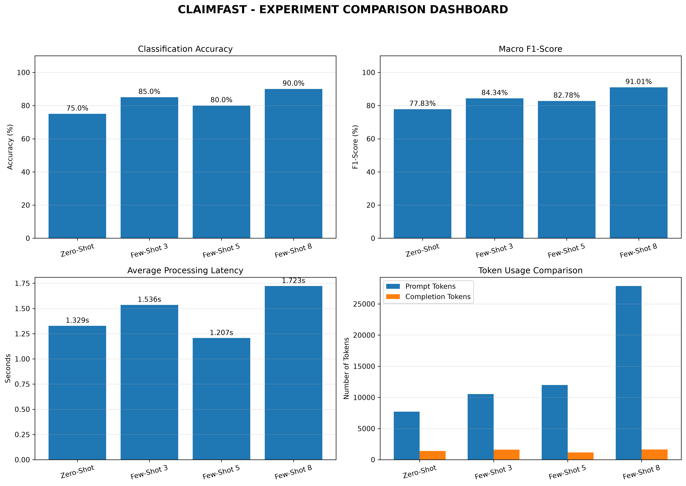

# CLAIMFAST
## Experimental Results and Performance Analysis

**Report Date:** 2026-11-06
**Project:** Insurance Claim Classification using LLMs

---

# 1. Introduction
ClaimFast is an experimental project designed to explore the use of Large Language Models (LLMs) for classifying insurance claim messages and extracting structured information.
This report compares four prompting approaches: Zero-Shot, Few-Shot 3, Few-Shot 5 and Few-Shot 8.

# 2. Experimental Methodology

The project evaluates four prompting configurations using recorded model predictions and evaluation results.

The experiments are:
- Zero-Shot Prompting
- Few-Shot Prompting with 3 examples
- Few-Shot Prompting with 5 examples
- Few-Shot Prompting with 8 examples

Each experiment contains 20 evaluated records according to the comparison report.

# 3. Evaluation Metrics

The following metrics were used:

- **JSON Validity:** Percentage of responses that produced valid JSON.
- **Classification Accuracy:** Percentage of correctly classified claim messages.
- **Macro F1-Score:** Average F1-score across claim categories, giving equal weight to each category.
- **Average Latency:** Average processing time in seconds.
- **Prompt Tokens:** Number of tokens used in the input prompts.
- **Completion Tokens:** Number of tokens generated in responses.

# 4. Experimental Results

| Experiment | Accuracy | Macro F1 | JSON Validity | Latency (s) | Prompt Tokens | Completion Tokens |
|---|---:|---:|---:|---:|---:|---:|
| Zero-Shot | 75.00% | 0.7783 | 100.00% | 1.329 | 7699 | 1389 |
| Few-Shot 3 | 85.00% | 0.8434 | 100.00% | 1.536 | 10539 | 1622 |
| Few-Shot 5 | 80.00% | 0.8278 | 100.00% | 1.207 | 11979 | 1174 |
| Few-Shot 8 | 90.00% | 0.9101 | 100.00% | 1.723 | 27879 | 1639 |

# 5. Classification Accuracy Analysis

- **Zero-Shot:** 75.00% accuracy.
- **Few-Shot 3:** 85.00% accuracy.
- **Few-Shot 5:** 80.00% accuracy.
- **Few-Shot 8:** 90.00% accuracy.

The highest classification accuracy was achieved by **Few-Shot 8**, with an accuracy of 90.00%.

# 6. Macro F1-Score Analysis

The highest Macro F1-score was achieved by **Few-Shot 8**, with a score of 0.9101.

# 7. Processing Latency Analysis

- **Zero-Shot:** 1.329 seconds.
- **Few-Shot 3:** 1.536 seconds.
- **Few-Shot 5:** 1.207 seconds.
- **Few-Shot 8:** 1.723 seconds.

**Few-Shot 5** recorded the lowest average latency at 1.207 seconds.

# 8. Token Usage Analysis

- **Zero-Shot:** 9,088 total tokens (7,699 prompt + 1,389 completion).
- **Few-Shot 3:** 12,161 total tokens (10,539 prompt + 1,622 completion).
- **Few-Shot 5:** 13,153 total tokens (11,979 prompt + 1,174 completion).
- **Few-Shot 8:** 29,518 total tokens (27,879 prompt + 1,639 completion).

# 9. Field-Level Accuracy Analysis

The following table compares the accuracy of individual information extraction fields.

| Field | Zero-Shot | Few-Shot 3 | Few-Shot 5 | Few-Shot 8 |
|---|---:|---:|---:|---:|
| claim_type | 75.00% | 85.00% | 80.00% | 90.00% |
| urgency | 45.00% | 75.00% | 80.00% | 75.00% |
| policy_number | 95.00% | 100.00% | 95.00% | 100.00% |
| incident_date | 85.00% | 85.00% | 90.00% | 75.00% |
| location | 100.00% | 90.00% | 95.00% | 90.00% |
| vehicle_reg_no | 80.00% | 90.00% | 85.00% | 90.00% |
| estimated_amount_inr | 100.00% | 100.00% | 100.00% | 100.00% |
| injury_reported | 95.00% | 95.00% | 100.00% | 95.00% |
| police_report_filed | 95.00% | 100.00% | 100.00% | 100.00% |

# 10. Experimental Visualization

The following dashboard presents the graphical comparison of the four experiments.

# 11. Discussion

The experimental results show that prompting strategy has an impact on classification performance.
Few-Shot 8 achieved the highest classification accuracy, while Few-Shot 8 achieved the highest Macro F1-score.
Few-Shot 5 provided the lowest processing latency.
The Few-Shot 8 approach achieved better classification performance but also consumed more prompt tokens and recorded higher latency than the other approaches.

# 12. Limitations

- Each experiment contains only 20 evaluated records.
- Results may vary with different datasets and models.
- Processing latency depends on the execution environment.
- Higher token usage can increase computational cost.
- Further testing with larger datasets is recommended.

# 13. Conclusion

Based on the recorded experimental results, Few-Shot 8 is the best-performing approach in terms of classification accuracy.
It achieved 90.00% accuracy and a Macro F1-score of 0.9101.
However, the choice of prompting strategy should also consider processing time and token consumption.
Future work should evaluate the system using a larger dataset and additional testing scenarios.